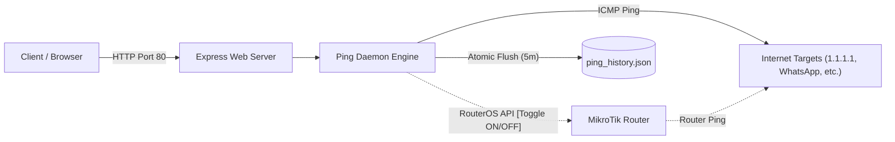

# 📡 Ping Monitor & Network Telemetry Dashboard

[](https://nodejs.org/)
[](https://www.typescriptlang.org/)
[](https://expressjs.com/)
[](https://opensource.org/licenses/MIT)
[](https://github.com/WahyuPR0/ping-monitor/pulls)

A high-precision, real-time network telemetry and latency/loss monitoring dashboard. Features **Dual-Source Telemetry** comparing latency and packet loss between your **Host Server** and your **MikroTik RouterOS** gateway simultaneously, with an instant **MikroTik Ping Toggle** switch.

Designed for homelabs, offices, and ISPs to detect ISP degradation, CDN edge anomalies, and local network jitter with second-by-second accuracy.

---

## ✨ Features

- ⚡ **Dual-Source Telemetry Engine:**
  - **Host Ping:** Measures reachability and socket performance directly from the server OS.
  - **RouterOS Hardware Ping:** Queries your MikroTik router (`/ping`) via API socket to isolate local LAN issues from true WAN uplink failures.
- 🎛️ **Live MikroTik Ping Toggle:**
  - Instantly turn MikroTik router pinging **ON** or **OFF** directly from the web dashboard or REST API without restarting the application.
  - Automatically switches between clean Single-Source (Host Only) and Dual-Source (Host + Router) modes.
- 📊 **Real-Time Interactive Dashboard:**
  - Modern dark-mode UI accessible at `http://<your-server-ip>` (Port 80 default).
  - High-frequency real-time charts (1-second live pulse).
  - SLA & Downtime calculations, average/min/max latency, and packet loss percentages.
  - Historical view ranges: **1 Hour**, **12 Hours**, **24 Hours**, **7 Days**, and **30 Days**.
- 🔍 **Interactive On-Demand Prober:**
  - Users can test any custom domain or IP (e.g. `google.com`, `1.1.1.1`, `8.8.8.8`) for instant live diagnosis without altering permanent monitoring settings.
- 💾 **SSD-Safe Atomic Persistence & Auto-Recovery:**
  - In-memory circular buffer with periodic 5-minute atomic flushes.
  - Automatic redundant backup (`ping_history.backup.json` and timestamped snapshots).
  - Auto-heals and recovers corrupted database files on startup seamlessly.
  - Survives reboots without wearing down SSD flash storage.
- 🔒 **Zero Privileged Overhead:**
  - Safe for local intranet sharing — read-only telemetry views without exposing router management or administrative commands.

---

## 🛠️ Architecture



---

## 🚀 Quick Start

### 1. Prerequisites
- **Node.js:** v18.0.0 or higher
- **Yarn** or **npm**
- *(Optional)* MikroTik Router with API service enabled (`/ip service enable api`).

### 2. Clone and Install
```bash
git clone https://github.com/WahyuPR0/ping-monitor.git
cd ping-monitor
yarn install
# or: npm install
```

### 3. Configuration
Copy `.env.example` to `.env`:
```bash
cp .env.example .env
```

Edit `.env` to configure your settings:
```env
# Server Port (Default 80 for direct browser access)
PORT=80

# Custom Ping Targets (Comma-separated host:Label or host)
# Leave empty or omit to use defaults (Cloudflare, Google, WhatsApp, WhatsApp CDN, YouTube)
PING_TARGETS=1.1.1.1:Cloudflare DNS,8.8.8.8:Google Public DNS,c.whatsapp.net:WhatsApp Chat,mmg.whatsapp.net:WhatsApp Media CDN,youtube.com:YouTube

# Optional: MikroTik RouterOS API Integration
# Disabled by default (false). Set to true only if you have a MikroTik router and want dual-source telemetry.
ENABLE_ROUTER_PING=false
MIKROTIK_HOST=192.168.88.1
MIKROTIK_PORT=8728
MIKROTIK_USER=admin
MIKROTIK_PASSWORD=your_router_password
```

### 4. Build and Run
```bash
# Build TypeScript
yarn build

# Start Server
yarn start
```

Open your browser at **`http://localhost`** (or **`http://<server-ip>`** from any device in your network).

---

## 🖥️ Running as a 24/7 Background Service

### Windows (Task Scheduler)
Helper batch files are included:
- **`start.bat`**: Starts the service via Task Scheduler.
- **`stop.bat`**: Stops the service cleanly.
- **`restart.bat`**: Gracefully flushes state and restarts.

To register as a background service:
```powershell
$action = New-ScheduledTaskAction -Execute "node.exe" -Argument "build/index.js" -WorkingDirectory "C:\Project\ping-monitor"
$trigger = New-ScheduledTaskTrigger -AtLogOn
Register-ScheduledTask -TaskName "PingMonitor" -Action $action -Trigger $trigger -Description "Ping Monitor Service"
```

### Linux (systemd)
Create `/etc/systemd/system/ping-monitor.service`:
```ini
[Unit]
Description=Ping Monitor Dashboard
After=network.target

[Service]
Type=simple
User=root
WorkingDirectory=/opt/ping-monitor
ExecStart=/usr/bin/node build/index.js
Restart=always
RestartSec=5
Environment=PORT=80

[Install]
WantedBy=multi-user.target
```
Enable and start:
```bash
sudo systemctl daemon-reload
sudo systemctl enable --now ping-monitor
```

---

## 📡 REST API Reference

| Endpoint | Method | Payload / Query | Description |
| :--- | :---: | :--- | :--- |
| `/` | `GET` | - | Web Dashboard UI |
| `/health` | `GET` | - | Server health status & uptime |
| `/api/ping/config` | `GET` | - | Get current router ping state & configuration |
| `/api/ping/toggle-router` | `POST` | `{"enabled": true/false}` | Toggle MikroTik ping live without restart |
| `/api/ping/telemetry` | `GET` | `target`, `range`, `source`, `zoom` | Time-series telemetry points & stats |
| `/api/ping/probe` | `GET` | `target=<ip-or-domain>` | On-demand single ping probe |
| `/api/ping/targets` | `GET` | - | List of permanently monitored destinations |

---

## 📄 License

This project is licensed under the [MIT License](LICENSE) - see the LICENSE file for details.

Developed with ❤️ by [Wahyu (WahyuPR0)](https://github.com/WahyuPR0).
